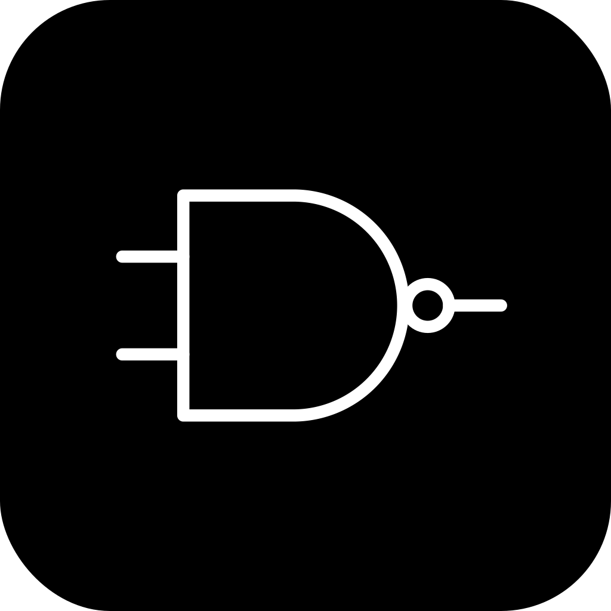

# Lathe

Pay only when circuits pass.

Order a small TapeOut circuit on X Layer, lock the USDT up front, and the builder gets paid only when the circuit gives the right answer for every possible input. A contract runs the check. No reviewer decides.

Status: entered in X Layer TapeOut Accelerate (deadline Dec 7, 2026). The order contract and the order page are built, including one-bit memory circuits, receipts, input names, and orders made of up to 8 wired pieces, optionally delivered at the end as one top circuit (the page shows pieced orders read-only for now). The wired pieces and the top circuit run on local test chains only so far. The contract runs on X Layer testnet at `0xde9A8a4b40d490C9Eff56157129902dc1d3D00b7` with stand-in circuits, because TapeOut is not on testnet. It is not on mainnet yet. Test records are in [evidence/](evidence/README.md).

## The problem

TapeOut puts real logic chips on X Layer, and apps like games and agent wallets run their rules on them. Getting one built today means learning NAND design yourself, or paying a builder up front and hoping it works.

TapeOut already lets a contract run any circuit with `eval`. So a contract can check the work before it pays.

## How an order works

1. **The buyer writes the rule as a full table.** Up to 6 yes/no inputs, so 64 cases, each with its expected output. Small enough to test every case, not a sample.
2. **The buyer locks USDT** in the order contract, with a delivery deadline, and names the one builder who may deliver.
3. **The named builder delivers.** They mint the circuit on TapeOut and submit its ID.
4. **The contract runs all 64 cases** through `eval`, in batches if one transaction can't hold them all.
5. **Every output matches: the builder gets paid.** One miss: no payment. If nothing passes by the deadline, the buyer takes the money back.

A passed circuit stays on-chain and anyone can rerun it for free, so any app can check the rule before it relies on it.

## Orders made of pieces

A table can only cover 6 inputs. A rule like "the amount is at least the limit, and two of three people approved" has 19 inputs. Its table would have 524,288 rows, and no one can check that many cases through one circuit.

So a buyer can split the rule into **pieces**: one or two in the fixed wiring below, or up to 8 with wires the buyer lists. Each piece is its own circuit, with no memory, delivered on its own with `deliverPiece`. A piece is one of:

- a **table**, like a normal order, up to 6 inputs;
- a **formula** the contract works out itself, so no table is stored: "a is at least b" (one output) or "a plus b", on two numbers of up to 17 input bits together. a is the first input bits, b the ones after it, each lowest bit first.

**How the check works.** Each piece is checked alone, on every one of its own inputs. A 16-input piece has 65,536 cases. That is too many for one transaction, so anyone pushes the check forward in batches with `checkPiece`, for example with [scripts/crank.mjs](scripts/README.md). A wrong answer clears only that piece's delivery; the other piece keeps its state. The order pays the builder once every piece has passed.

**Why the joined rule is right.** The pieces are wired in one fixed way. The second piece gets the first piece's outputs as its first inputs, then the order's remaining inputs. Since each piece is right on all of its own inputs and the wiring is fixed, the joined rule is right too. The joined rule is not checked again as a whole. `run` on a paid order joins the pieces the same way.

**Wired pieces (up to 8).** The buyer can instead list every wire: which order input or which earlier piece's output bit feeds each piece input, and which piece output bits are the order's outputs. A piece can only be fed by the order's inputs or by an earlier piece, every piece input and order output gets exactly one wire, and every order input must feed something; any other list is refused when the order is made. [examples/daily-cap.json](examples/daily-cap.json) is a daily spending cap: piece 1 adds "spent today" and "this amount" (two 8-bit numbers), piece 2 asks "is the cap at least that sum". The same argument holds: each piece is checked on all its inputs and the contract always wires them as listed.

**One circuit at the end (a "top circuit").** When the order is made, the buyer picks one of two kinds, fixed from then on:

- **Lathe joins**: the order pays when the last piece passes, and the contract joins the pieces each time the rule runs. `ruleOf` names a circuit only when one circuit already is the rule as it stands: a 1-piece order made without wires, or with wires that feed order input i to piece input i and piece output j to order output j, and nothing else. For any other joined order (2 or more pieces, or 1 piece whose wires swap, share or drop bits) the piece circuit computes something else, so the receipt names no circuit and `ruleOf` reverts `NoSingleCircuit`; `run` still gives the rule.
- **Needs a top circuit**: after every piece has passed, the builder delivers one more circuit (`deliverTop`) made only of links to the tested piece circuits (TapeOut's REF records), wired as the order says. The contract builds the exact bytes that circuit must have (`expectedTopNetlist`) and compares their hash with the delivered circuit's, plus its input and output counts. If they match, the order pays and `ruleOf` names that one circuit, so other contracts can use the rule as a single circuit: it takes the order's inputs and gives the order's outputs, exactly as the order says. The top circuit is not checked case by case: its bytes say "run these tested circuits, wired this way", and nothing else, so it is right because the pieces are. The builder has until one day after the deadline to deliver it; refunds follow the same rules as before.

Both kinds of the same wiring share one fingerprint in the receipt (`piecedHash`: the pieces, their tables and the wires), because the rule is the same; the kind is in `needsTop`.

Not every wiring can be one top circuit: TapeOut takes a circuit's outputs from its last wires, so the order's outputs must be the last output bits of the last piece(s), in order. Other wirings are refused as "needs a top circuit" (`TopNeedsLastOutputs`) but can still be ordered as "Lathe joins".

**What the daily cap costs to check.** About 1,210 transactions and 0.68 OKB if each piece is a small circuit of about 70 gates; the transaction count is from the crank's own plan, the gas from stand-in circuits that burn what a real circuit that size is estimated to burn ([evidence](evidence/2026-11-21-daily-cap-check-cost.md)). At 150 gates per piece it is about 1.4 OKB, at 650 gates about 6 OKB, so the buyer should cap the pieces' gates.

**What can still go wrong.**

- A piece that passed cannot be replaced. If TapeOut's owners change a passed piece's circuit before the order pays (they can upgrade the processor code), the payout refuses (`CircuitChanged`) and the order can never pay. The buyer then takes the money back after the deadline and its one-day grace.
- Running a paid rule made of pieces gives each piece its full gas budget, one after the other. A top circuit is run once, after the contract confirms no piece circuit changed, with `100,000 + 15,000 × its gates + 150,000 × pieces` gas, because each link to a piece costs about 33,000 gas or more on real TapeOut ([evidence](evidence/2026-11-21-top-run-gas.md)). With big circuits that can pass the about 50M gas that public X Layer nodes allow in a free call. The order page then says it cannot run the rule, rather than show an answer it did not get.
- A piece that is itself made of links to other circuits costs about 31,000 more per level of links, which the contract cannot count. The top's run budget covers it through each piece's own budget (a piece only passes if its own run fits that), and did on every wiring measured. If a top ever needs more, the free `run` refuses (never a wrong answer); `ruleOf` still names the top, and calling `eval` on the processor directly with more gas still runs it.

**What a 16-input piece costs.** Measured on a copy of X Layer mainnet with a circuit built like the real 652-gate 8x8 multiplier: about **1.5M gas per case** ([evidence](evidence/2026-11-21-gas-16-input-piece.md)). From that measured figure, all 65,536 cases come to about 98B gas, about 1.97 OKB at that day's gas price of 0.02 gwei. That total is a projection, and the gas price moves. The crank then needs about 3,450 transactions, because each case must be handed its whole 9.88M gas budget. A small comparator of about 70 gates took 400 transactions in a local test run with stand-in circuits ([evidence](evidence/2026-11-21-crank-anvil-run.md)); its cost of about 0.22 OKB is an estimate, not a measurement of a real circuit.

## What we checked (read-only, X Layer mainnet, Nov 16 2026)

| Question | Answer |
|---|---|
| Can a contract get an answer from someone else's circuit? | Yes. A 1,204-gate circuit returned output through `eval`. |
| Cost of one run | About 2,290 gas per gate: about $0.005 for that 1,204-gate circuit. |
| Cost of checking all 64 cases | About $0.32 for the 1,204-gate circuit. About a cent for a 50-gate rule. |
| Does one transaction hold all 64 cases? | For a 50-gate rule, yes (about 7M gas). For the 1,204-gate circuit, about 180M gas: under the 210M block limit, but over 16.7M, the per-transaction cap Ethereum and Base use. X Layer's per-transaction cap is not confirmed, so the check runs in batches. |
| Can the contract read gate count? | Yes, `circuitInfo(id)`. |
| Cost for a builder to mint a circuit | About 0.0013 OKB plus the gates used. No BEM or FAB needed on existing processors. |

Not yet tested: a contract calling a circuit chosen at claim time inside one transaction (reasoned, not simulated).

## Known limits

- A table covers at most 6 inputs. Bigger rules use pieces: up to 8 with listed wires (two without), each either a table of up to 6 inputs or one of two formulas ("a is at least b", "a plus b") of up to 17 inputs; an order has at most 64 inputs and 64 outputs. Wires cannot carry the constants 0 and 1. The order page shows wired orders but cannot create them yet.
- Who can change the circuit runner: the processor factory is owned by a 3-of-5 multisig and is not sealed; the circuit beacon's owner is the zero address (read-only check, Nov 15 2026). We have not audited every upgrade path, so Lathe pins and inspects the exact processor before any order takes money.
- Lathe takes a fee on each paid order. Rate not set.
- Every order names its builder. Open orders, where any builder may deliver, come after Dec 7: an open order lets anyone mint a copy of the honest builder's circuit, or wrap it, and deliver first.
- A processor that returns badly encoded data (from `eval`, `step`, `circuitInfo` or `netlist`) makes `check` revert instead of counting a wrong answer. A delivered order then cannot finish its check: it waits until one day after its deadline, and then the buyer gets a refund. Only TapeOut's factory owners, who can change the processor code, could cause this. A builder cannot: a builder only picks a circuit, not the code that runs it.

- The contract is four contracts: `LatheOrders`, which holds the money, and three linked libraries: `LatheChecks` (the rules checked when an order is created), `LatheReads` (`run`, `runStep` and the wiring) and `NetlistLib` (builds the top circuit's expected bytes). This keeps `LatheOrders` under the contract size limit (22,555 of 24,576 bytes). The libraries hold no money and cannot change an order on their own. A deploy sends all four ([DEPLOY.md](DEPLOY.md)).
- A circuit made mostly of links (REF records) to very small circuits can be refused although it is right. Each case gets `100,000 + 15,000 × gates` gas, and a link costs about 31,000 plus 2,300 per gate of the circuit it links to, but adds only that circuit's gates. Measured on a mainnet copy: a circuit made only of links to a 1-gate circuit passes with up to 4 links and is refused with 5; links to a 2-gate circuit, up to 13; links to circuits of 3 or more gates passed at every length tried (up to 24); a link to a circuit that is itself a link to a 1-gate circuit, only 1; two levels deep, none ([evidence](evidence/2026-11-21-ref-heavy-circuit-budget.md)). A refusal moves no money: the order stays open (or opens again), and the builder can deliver the same logic with plain gates or fewer links to bigger circuits. This applies to plain orders and to pieces. A builder-chosen per-case budget would remove it (about 400 more bytes, not built).
- A top circuit that references a circuit which itself references others: Lathe checks that the piece circuits are unchanged before every run, but not the circuits those reference. This is the same for a plain order delivered as such a circuit.

## Roadmap to Dec 7

- [ ] Order contract on X Layer mainnet (lock, deliver, check in batches, pay, refund)
- [x] Order page in English and Chinese (`web/`, run it locally: see [web/README.md](web/README.md))
- [ ] One real order paid on mainnet, funded by someone other than the author
- [ ] Demo video

## License

MIT
